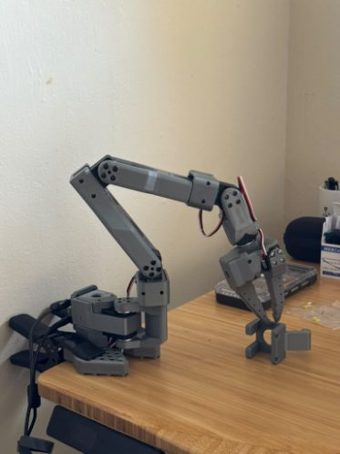
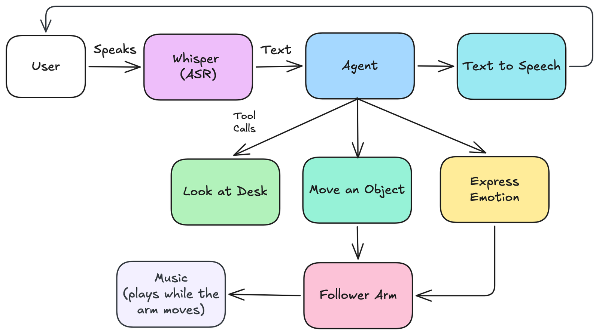
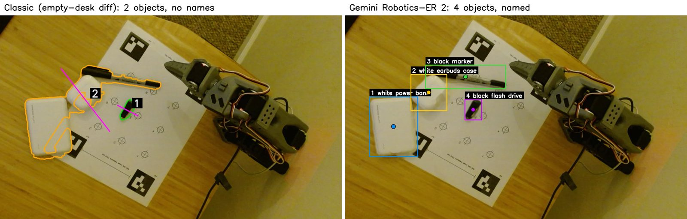

<p align="center">
  
</p>

<div align="center">

[](./LICENSE)
[](https://www.python.org/downloads/)
[](#installation)
[](https://huggingface.co/docs/lerobot/so101)

</div>

**Goof-E, MK I** is a clumsy desk robot inspired by Tony Stark's [Dum-E](https://www.youtube.com/watch?v=_dsG4h1FjIo). It's a low-cost [SO-101](https://huggingface.co/docs/lerobot/so101) arm, a webcam on a boom arm, and an AI agent that listens, looks at the desk, plans, and moves things around.

🦾 Safe, smooth control of the SO-101 follower arm on top of [LeRobot](https://github.com/huggingface/lerobot), with speed limits and joint clamping.

👀 A top-down camera calibrated to the desk with a printed ArUco sheet, so every pixel maps to a spot on the desk.

🔎 Object finding with [Gemini Robotics-ER 2](https://deepmind.google/models/gemini-robotics/embodied-reasoning/), with a classic computer-vision fallback.

🧠 A voice agent powered by Claude that plans and calls tools: look at the desk, move an object, remember or forget a place, express an emotion.

🎶 Personality: happy and sad gestures, a spoken voice, and music while the arm moves to soften the sound of the motors.

## Demo

<p align="center">
  <a href="https://www.youtube.com/watch?v=JQc6S-O5MP4">
    
  </a>
</p>

The full build story (parts, assembly, calibration, and what I learned) is on my blog: [Goof-E, MK I: I Built Tony Stark's Clumsiest Robot for My Desk](https://www.preetamjoshi.com/writing/goof-e/).

## Hardware

| Part | Notes |
|---|---|
| [SO-101 arm kit](https://huggingface.co/docs/lerobot/so101), leader + follower | I used the unassembled kit from [HiWonder](https://www.hiwonder.com/products/lerobot-so-101). Each arm has a servo driver board and its own power adapter. |
| Logitech C920 webcam | Mounted on a boom arm, looking straight down at the desk. |
| USB-C hub with its own power | The two arms and the webcam need more ports and power than a laptop provides. |
| Sturdy desk clamps | To hold both arm bases firmly. |
| Precision screwdriver set | A magnetic tip helps a lot with the tiny servo screws. |
| A Mac with Apple Silicon | Speech-to-text runs on device with MLX Whisper. |

Assembly follows the [LeRobot SO-101 guide](https://huggingface.co/docs/lerobot/so101).

## Installation

Goof-E runs on macOS with Apple Silicon and Python 3.12.

```bash
# 1. Create an environment (conda or venv both work)
conda create -y -n lerobot-mac python=3.12
conda activate lerobot-mac

# 2. Get the code and install dependencies
git clone https://github.com/pjoshi30/goof-e.git
cd goof-e
pip install -r requirements.txt

# 3. Add your API keys and hardware settings
cp .env.example .env
```

Then fill in `.env`:

| Setting | What it's for |
|---|---|
| `ANTHROPIC_API_KEY` | Claude, the planner and conversation (required for the voice app). |
| `GEMINI_API_KEY` | Gemini Robotics-ER 2, which finds and names objects. The free tier allows about 20 requests a day. |
| `OPENAI_API_KEY` | Optional. A natural speaking voice; without it, the browser's built-in voice is used. |
| `GOOFE_FOLLOWER_PORT`, `GOOFE_LEADER_PORT` | Serial ports of the two arms. Find them with `lerobot-find-port`. |
| `GOOFE_CAMERA_INDEX` | Which camera is the top-down webcam. Check with `python -m deskbot.snap`. |

> [!NOTE]
> Run camera commands from the macOS Terminal app, so it can ask for camera permission. The `.command` launchers do this for you when double-clicked.

## Calibration

The files in `calib/` and `poses.json` are from my desk and serve as examples. Redo these steps for your own setup.

1. **Motors and arms.** Follow the [LeRobot calibration video and steps](https://huggingface.co/docs/lerobot/main/en/so101#calibration-video).
2. **Teach poses.** `python -m deskbot.teach`: move the leader arm and the follower mirrors it. Save at least `rest`, `neutral`, `happy` and `sad`.
3. **Print the target sheet.** `python -m deskbot.targets` writes `calib/targets.pdf`. Print it at 100% and check that the scale line measures 10.0 cm. Tape it flat in the arm's reach and the camera's view, about 15–30 cm from the base.
4. **Camera to desk.** `python -m deskbot.snap 0`, then `python -m deskbot.calib_camera`. This maps pixels to desk coordinates to within about 0.5 mm. Check `calib/camera_check.jpg`.
5. **Arm to desk.** `python -m deskbot.calib_arm`: touch each target (1–9, m0–m3) with the closed gripper tip using the leader arm, then press `q`. This fits where the arm sits; mine averages about 4 mm of error.
6. **Check it.** `python -m deskbot.touch_test`: click spots in the camera image and see how close the tip lands.

Afterwards only the camera must stay put; the sheet can be removed.

## Usage

The quickest start is the voice web app:

```bash
open run_app.command   # opens http://127.0.0.1:8765
```

Hold the button (or the space bar) to talk, or type. Try "put the marker next to the power bank" or "show me you're happy". **Ctrl+C at any time freezes the arm, then parks it at `rest`.**

<details>
<summary><b>All commands</b></summary>

| Command | What it does |
|---|---|
| `python -m deskbot.status` | Prints joint positions and limits. Never moves the arm. |
| `python -m deskbot.teach` | Follower mirrors the leader; type a name and press Enter to save a pose. |
| `python -m deskbot.emote happy` / `sad` | Plays an emotion. |
| `python -m deskbot.targets` | Writes `calib/targets.pdf`, the calibration sheet. |
| `python -m deskbot.calib_camera` | Maps camera pixels to desk coordinates from the sheet's markers. |
| `python -m deskbot.calib_arm` | Touch the sheet's targets with the gripper tip; fits where the arm sits. |
| `python -m deskbot.touch_test` | Click the camera image; the arm touches that spot. |
| `python -m deskbot.hover 5 20` | Holds the tip 20 mm above target 5, to measure the real gap. |
| `python -m deskbot.perceive --background` | Saves the empty desk (arm parked at rest). Redo if the lighting or sheet changes. |
| `python -m deskbot.perceive` | Finds objects; prints position, size and grip angle, and writes `snapshots/objects.jpg`. |
| `python -m deskbot.perceive --er2` | Same, but Gemini Robotics-ER 2 finds and names the objects. |
| `python -m deskbot.pick_place` | Click an object, then where it should go; the arm moves it. `--classic` uses the empty-desk method. |
| `open run_app.command` | The voice web app. |

</details>

## How it works

<p align="center">
  
</p>

1. **Listen.** Speech is transcribed on the Mac with [MLX Whisper](https://huggingface.co/mlx-community/whisper-large-v3-turbo). Audio never leaves the machine.
2. **Think.** A Claude agent decides what to do and calls tools: `look_at_desk`, `move_object`, `remember_place`, `forget_place` and `express_emotion`. Because it's an agent loop, the arm can check its work and correct itself mid-task.
3. **See.** Gemini Robotics-ER 2 finds and names objects, and its points split touching objects apart. The classic method compares the live image with a photo of the empty desk, and remains as a fallback.
4. **Act.** Inverse kinematics turns a desk position into joint angles. After each move the arm re-reads its joints and corrects for servo sag.
5. **Talk and emote.** Replies are spoken aloud, gestures come from taught poses, and music plays while the arm moves (inspired by [Catie Cuan](https://catiecuan.com/)'s "music mode" for robots).

<p align="center">
  
  <br><sub>Classic vision + Claude (left) merges touching objects; Gemini Robotics-ER 2 (right) separates and names them.</sub>
</p>

<details>
<summary><b>Project layout</b></summary>

```
deskbot/
  agent.py         Claude as the robot's brain: hears a request, looks, calls the arm's tools
  desk.py          The robot's abilities as plain methods, exposed to the agent as tools
  webapp.py        Local web app: hold to talk, listen, think, act (static/index.html is the UI)
  voice.py         Speech to text on the Mac (MLX Whisper)
  speech.py        Speaking voice (OpenAI Realtime API, optional)
  arm.py           Safe, smooth SO-101 control on top of LeRobot
  kinematics.py    Forward/inverse kinematics and the touch-calibration fit
  motion.py        Cartesian moves: go above a point, descend, come back up
  grasp.py         Pick an object up and put it down elsewhere
  camera.py        Capture and the pixel <-> desk mapping
  er2.py           Object finding with Gemini Robotics-ER 2
  perception.py    Classic object finding against an empty-desk photo
  emotions.py      Expressive gestures built from taught poses
  config.py        Hardware settings (read from .env)
calib/             Calibration results (examples from my desk)
music/             Drop an audio file here to play while the arm moves
```

</details>

## Limitations

Goof-E, MK I was built in about two weeks, and it is clumsy by design:

- It only reasons about the desk in 2D. There's no depth or wrist camera, so it can't judge height or how an object will balance.
- It doesn't predict consequences. It will happily put an object at the edge of the desk and watch it fall.
- Lighting matters for the classic detector; Gemini Robotics-ER 2 is much more robust.
- Tip accuracy is about 4 mm after calibration, which is enough for pens and AirPods cases but not for fine work.

Next up: a proper evaluation of its failure and success modes, and a real-to-sim version of the desk.

## Resources

- **[Build write-up](https://www.preetamjoshi.com/writing/goof-e/):** the story behind Goof-E, with photos.
- **[LeRobot SO-101 docs](https://huggingface.co/docs/lerobot/so101):** sourcing, assembly and calibration of the arm.
- **[Gemini Robotics-ER](https://deepmind.google/models/gemini-robotics/embodied-reasoning/):** the robotics-tuned model used for object finding.
- **[Choreorobotics and music mode](https://youtu.be/MJhesGakX1w?t=663):** Catie Cuan's talk that inspired the music.

## Citation

If Goof-E is useful in your project, you can cite it:

```bibtex
@misc{joshi2026goofe,
    author = {Joshi, Preetam},
    title = {Goof-E: A Clumsy, Voice-Driven Desk Robot on the SO-101 Arm},
    howpublished = "\url{https://github.com/pjoshi30/goof-e}",
    year = {2026}
}
```

## Contribute

Issues and pull requests are welcome, whether it's a bug fix, support for another camera or arm, or a better grasp. If you build your own Goof-E, I'd love to see it.

## License

[MIT](./LICENSE). LeRobot and the models Goof-E calls are covered by their own licenses and terms.

<div align="center">
<sub>Built by <a href="https://www.preetamjoshi.com">Preetam Joshi</a> on <a href="https://github.com/huggingface/lerobot">LeRobot</a>, with help from Claude Code.</sub>
</div>
